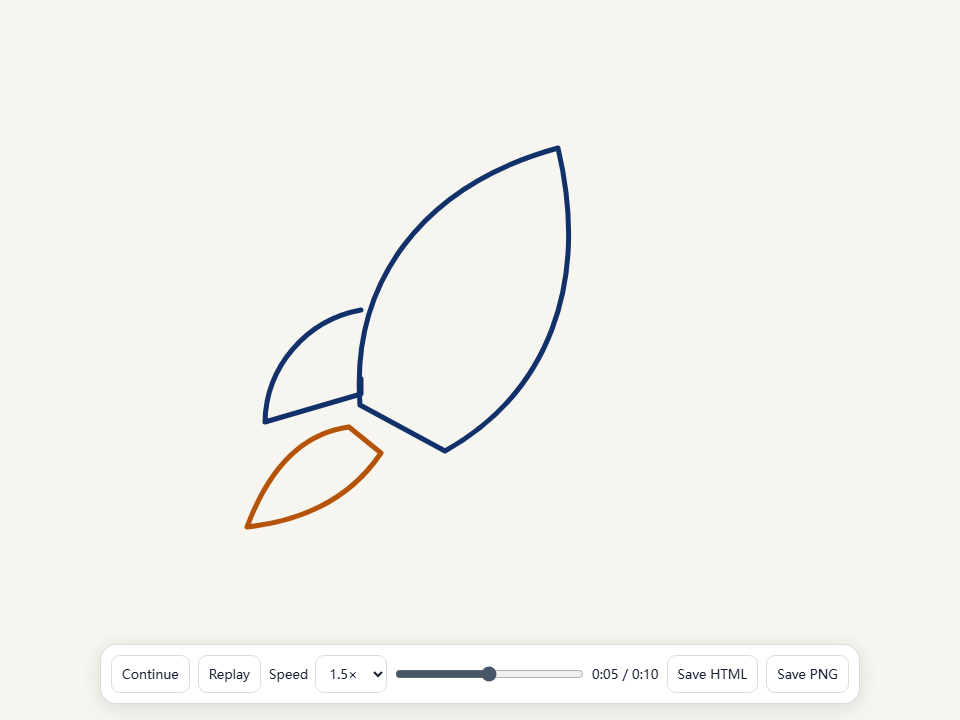
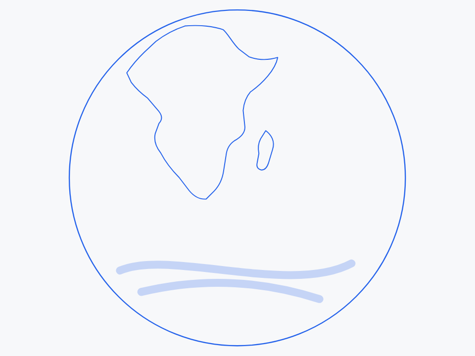

# TypeBit

[实测记录与独立 Agent 验收](docs/validation.md)

**让静态图片，以描线动画的方式出现。**

TypeBit 是一个 Agent Skill，用于把 SVG、Logo、线稿和照片制作成独立 HTML 线条动画。宿主 Agent 负责理解图片和根据对话修改，TypeBit 负责保存工程、使用原生 SVG 播放，并在真实浏览器中检查导出的文件。

[English](README.md) · [安装 Skill](#安装-skill) · [下载版本](https://github.com/JulyanXu/typebit/releases) · [反馈问题](https://github.com/JulyanXu/typebit/issues)


*这里展示的是实际播放录制；导出的 HTML 打开后等待操作，可以调整速度和进度。*

## 从图片到可交付动画

1. 给 Agent 一张图片，请它制作线条动画。
2. 查看真实预览、调整播放速度，或拖动进度检查某一帧；画面修改直接用自然语言反馈。
3. 按用途选择独立 HTML、GIF 动画或 PNG 图片，并保留可编辑工程与验证报告。

默认顺序是主要结构、次要轮廓、文字与细节，最后显露颜色。总时长约 10 秒，完成后定格。主体外部保持透明，默认不添加原图以外的装饰；用户提出要求时，可以在主体后方加入蓝色涂鸦。

**无需新账号、单独安装 AI 模型或配置推理 API。** TypeBit 使用宿主 Agent 已有的视觉和图像工具。它不包含独立网站、可视化编辑页或云端图片处理服务。播放器采用原生 SVG 与 JavaScript，不依赖 GSAP。


## 素材与处理方式

| 输入 | 处理方式 |
| --- | --- |
| SVG | 复用受支持的原始图形，安排描线顺序。文字需转为路径，或明确提供可嵌入的正确字体。 |
| PNG / JPEG Logo、线稿 | 由宿主协助生成轮廓路径，保留原图颜色像素，并修正透明区域。 |
| 照片 | 使用宿主视觉／图像工具制作简化轮廓和主体蒙版，最后显露蒙版内的原图。 |

照片采用 **“近似轮廓＋原图显露”**，不承诺自动、完美地将任意照片还原为矢量。能看懂图片不代表具有精确分割工具；宿主无法提供可用蒙版时，应保存已有工作，并说明主体分离尚未完成。位图没有轮廓路径时，不能直接渲染为已完成的线条动画。

## 安装 Skill

下载一个发布版本，或克隆本仓库。将 `skills/typebit-line-animation` **整个文件夹**复制到宿主的 Skill 目录：

请使用 **v0.2.0 或更新版本**，以获得速度控制、多格式导出和默认关闭装饰的修复；`v0.1.0` 发布 ZIP 保持原有行为。旧工程需要移除装饰时，可执行 `configure PROJECT --doodle off`，再重新渲染和验证。

| 宿主 | 个人 Skill 目录 | 调用方式 |
| --- | --- | --- |
| Codex | `~/.agents/skills/typebit-line-animation/` | `$typebit-line-animation` |
| Claude Code | `~/.claude/skills/typebit-line-animation/` | `/typebit-line-animation` |
| 其他 Agent | 宿主支持的 Skill 位置；也可以让 Agent 直接读取复制后的 `SKILL.md` | 依宿主而定 |

只在某个项目中使用时，Codex 可放在项目的 `.agents/skills/`，Claude Code 可放在 `.claude/skills/`。目录依据宿主的 [Codex 文档](https://learn.chatgpt.com/docs/build-skills)和 [Claude Code 文档](https://code.claude.com/docs/en/skills)。图片、文件与浏览器工具取决于实际宿主；安装 Skill 不会自动赋予这些能力。

参考运行环境为 **Python 3.12**。在仓库根目录、使用选定的 Python 环境执行：

```text
python -m pip install -r skills/typebit-line-animation/requirements.txt
python -m playwright install chromium
python skills/typebit-line-animation/scripts/typebit.py doctor
```

若已将 Skill 单独复制出去，在复制后的目录执行同样步骤，将路径改为 `requirements.txt` 和 `scripts/typebit.py`。系统命令为 `python3` 时，所有步骤统一使用它。建议使用独立虚拟环境。详细说明见[环境与宿主指南](skills/typebit-line-animation/references/environment.md)。

安装依赖和 Chromium 需要下载文件。**导出后的 HTML 可以离线播放**，不再依赖 Python、TypeBit 或原工程目录。素材处理依赖 Pillow 和 defusedxml；浏览器验证还需要 Playwright 及其安装的 Chromium。Linux 可能需要额外安装 [Playwright 系统依赖](https://playwright.dev/python/docs/intro)。

## 向 Agent 发出请求

```text
使用 $typebit-line-animation 处理我上传的图片。保留主体形状、文字字形和颜色，
制作透明背景、约 10 秒的线条动画。给我真实预览，验证离线播放，
最后交付独立 HTML、可编辑工程和验证报告。
```

Claude Code 中使用 `/typebit-line-animation`；其他宿主可直接提及 Skill，或提供其 `SKILL.md` 路径。

随后直接反馈：

> 文字放到最后画，右边的细节线条少一些，保留白色高光。

> 总时长改为 12 秒，默认用 1.5 倍速播放，再导出白底 GIF 和透明背景的最终 PNG。

如果旧工程带有不需要的装饰，可以说“去掉蓝色装饰”。Agent 会关闭装饰，保留原图内容。

Agent 会修改现有工程，并重新检查导出结果。调整速度、时长或格式会复用已有素材，无需重新描摹整张图片。HTML 工具栏负责播放和下载，画面内容仍通过对话修改。

## 运行内置 SVG 示例

完成依赖安装后，在仓库根目录执行：

```text
python skills/typebit-line-animation/scripts/typebit.py prepare examples/source/typebit-mark.svg --project build/example --kind svg
python skills/typebit-line-animation/scripts/typebit.py configure build/example --duration 12 --speed 1.5
python skills/typebit-line-animation/scripts/typebit.py render build/example
python skills/typebit-line-animation/scripts/typebit.py verify build/example/animation.html
python skills/typebit-line-animation/scripts/typebit.py export build/example --format gif --width 640 --fps 15
python skills/typebit-line-animation/scripts/typebit.py export build/example --format png
python skills/typebit-line-animation/scripts/typebit.py package build/example
```

打开 `build/example/animation.html`。示例时间线为 12 秒，以 1.5 倍速播放时实际用时 8 秒。额外格式位于 `build/example/exports/`；工程压缩包位于 `build/example-project.zip`；浏览器验证结果位于 `build/example/verification/report.json`、`report.md` 及同目录截图中。`configure` 与额外格式的 `export` 步骤可选。处理新素材时，仍需 Agent 理解和复核画面。

| 操作 | 行为 |
| --- | --- |
| 屏幕播放按钮／右方向键 | 开始播放；播放中重复按右方向键不会重置。结束后再次按键会重播。 |
| 空格 | 暂停或继续。 |
| R | 从头重播。 |
| 速度选项 | 在 0.25～4 倍速之间调整，改变速度时画面进度连续。 |
| 进度条 | 跳到指定画面并暂停。 |
| 下载 HTML | 保存独立副本，记住当前倍速；重新打开仍等待点击播放。 |
| 下载 PNG | 保存当前画面，保留透明度，不含工具栏。 |

显示的时间是画面在时间线中的位置；实际播放时长＝时间线时长÷倍速。若要保存工程的默认倍速，可让 Agent 调整，或执行 `configure PROJECT --speed 0.5`。若要把各阶段整体拉长，则用 `configure PROJECT --duration 20`。保存后重新渲染和验证。

## 选择导出格式



| 格式 | 适合用途 | 透明度与播放方式 |
| --- | --- | --- |
| HTML | 离线演示、交互播放 | 保留透明背景，可调速度，支持键盘和屏幕操作。 |
| PNG | 静态截图、最终成品图 | 默认保留完整透明度；命令行默认导出终帧，`--time` 可指定时间线位置。 |
| GIF | 文档或 GitHub 动画预览 | 来自真实浏览器帧，默认使用白色底；可通过 `--background "#RRGGBB"` 指定底色。 |
| 工程 ZIP | 继续交给 Agent 修改 | 包含素材、图层、时序、报告和已导出的文件。 |

GIF 通过 Agent／命令行导出，独立 HTML 工具栏只负责 HTML 和 PNG 下载。GIF 会使用选定的播放速度，但调色板格式不能保留平滑的半透明边缘；需要透明背景时请选择 HTML 或 PNG。更多参数和导出记录见[速度与格式指南](skills/typebit-line-animation/references/exports.md)。

处理宿主准备好的位图时，`prepare` 支持 `--mask PATH`、`--contours SVG`、`--kind logo|lineart|photo` 和 `--duration SECONDS`。`--remove-white-background` 只尝试移除与画面边界相连的近白区域，生成的透明候选仍需视觉确认；它不会无差别删除所有白色。

SVG 中保留文字对象时，使用 `--font PATH --font-family NAME` 提供正确且允许分发的字体。该字体会应用到所有文字，文字对象在最终显色阶段出现。若要逐步描绘文字笔画，或保留多种字体，应先将文字转为路径。不受支持的外部资源会被拒绝，不会在播放时联网补取。详见[工程与修改约定](skills/typebit-line-animation/references/project.md)。

## 运行真实照片示例

内置阿波罗 17 号 **“蓝色弹珠”** 照片，署名 **NASA / Apollo 17 crew**。三个示意轮廓由宿主 Agent 看图后编写，圆形蒙版只针对这张照片。这是近似处理示例，不是通用自动抠图。请保留[来源与使用说明](examples/source/ATTRIBUTION.md)；NASA 不为 TypeBit 背书。

| 近似轮廓 | 显露原始照片 |
| --- | --- |
|  |  |

```text
python skills/typebit-line-animation/scripts/typebit.py prepare examples/source/blue-marble.jpg --project build/photo-example --kind photo --mask examples/source/blue-marble-mask.png --contours examples/source/blue-marble-contours.svg
python -c "from shutil import copyfile; copyfile('examples/source/ATTRIBUTION.md', 'build/photo-example/ATTRIBUTION.md')"
python skills/typebit-line-animation/scripts/typebit.py render build/photo-example
python skills/typebit-line-animation/scripts/typebit.py verify build/photo-example/animation.html
python skills/typebit-line-animation/scripts/typebit.py package build/photo-example
```

照片测试会逐个比较解码后的全部 RGB 像素，并检查输出是否使用了提供的透明蒙版。圆形边缘可能略微裁掉大气边缘；云层和地表细节通过最后显露原图保留，不会被重新构造成大量路径。

## 最终保留的文件

- **`animation.html`**：内嵌 SVG、图片、播放器代码及必要字体，运行时不依赖网络。
- **工程目录与 ZIP**：保留原始素材、可编辑场景、图层／时序信息，以及工程使用的蒙版和字体。
- **验证报告与截图**：记录这份导出文件在本次浏览器验证中的实际表现。
- **`exports/`**：按需导出的 GIF、PNG 或 HTML 副本，以及导出参数和源文件／输出文件校验值。
- **版本记录**：再次渲染时，在本地保留此前已渲染的工程快照。交付 ZIP 只包含当前工程；需要历史记录时应另行保留 `revisions/`。

## “已验证”代表什么

验证器通过 `file://` 打开导出的 HTML，禁用网络，检查播放操作，并在浅色、深色、棋盘格背景下截取开场、中间态和最终画面。Agent 另外检查原图相似度、文字字形、轮廓质量，以及白色和透明区域。

浏览器测试通过 **不等于** 视觉效果已经合格。浏览器不可用、主体蒙版不完整、未执行的检查，都必须准确披露。CI 工作流配置或另一个示例的报告，不代表当前作品已验证。以每份作品附带的报告为准；安装说明也不等于所有宿主或 CI 环境均已实测。

## 开发、发布与维护

运行脚本、Skill 指令和参考文档统一放在 `skills/typebit-line-animation/`。GitHub 仓库承担文档、展示和分发职责。发布附件提供可安装 Skill 与示例；用户作品不会自动上传或公开。

修改时应保留原图像素、稳定的离线输出、播放操作约定和真实验证记录。可查看[版本记录](CHANGELOG.md)、[Skill 工作流程](skills/typebit-line-animation/SKILL.md)和[验证指南](skills/typebit-line-animation/references/verification.md)。反馈问题时请提供 TypeBit 版本、`doctor` 输出及验证报告；只有确实准备公开分享时才附上原图。

维护者可先运行 `python tools/validate_skill.py` 与 `python -m unittest discover -s tests -v`，再执行上面的示例流程。[检查工作流](.github/workflows/checks.yml)为 Ubuntu、Windows、macOS 配置了 Python 3.12 检查，并保留浏览器验证证据。已配置工作流不代表已通过，应以 [Actions 实际结果](https://github.com/JulyanXu/typebit/actions)为准。

发布时更新运行时版本与版本记录，再推送对应的 `vX.Y.Z` 标签。[发布工作流](.github/workflows/release.yml)完成检查后，发布经过测试的 Linux 示例、Skill ZIP、验证证据和校验值。CI 没有 Agent 看图，因此视觉复核仍标为未验证。本地 Agent 进行的视觉复核绑定其对应 HTML 的哈希，不会自动沿用到另一次构建的文件。

采用 [MIT 许可](LICENSE)，Copyright © 2026 Julyan Xu。依赖和用户素材保留各自许可，详见[第三方说明](THIRD_PARTY_NOTICES.md)。
