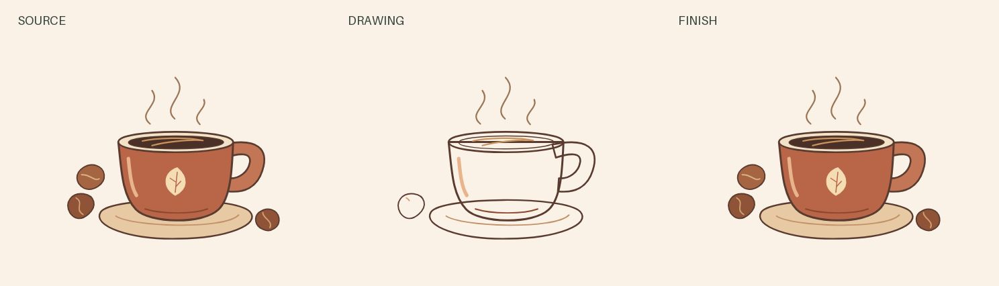
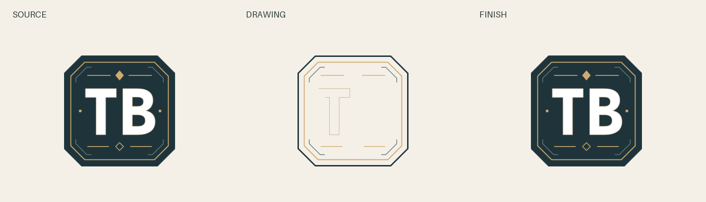
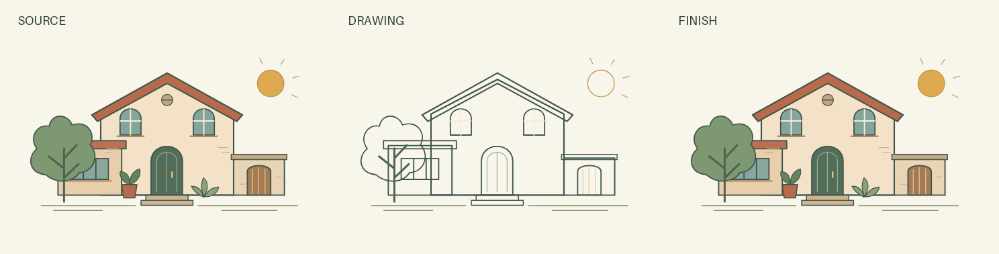
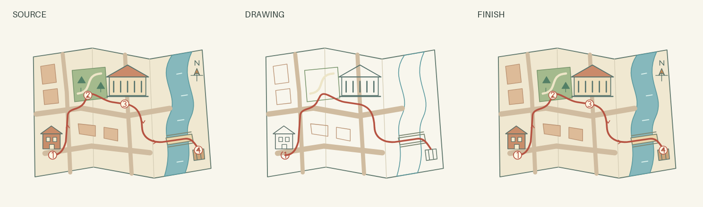
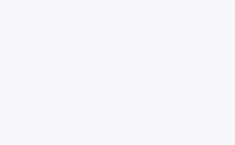
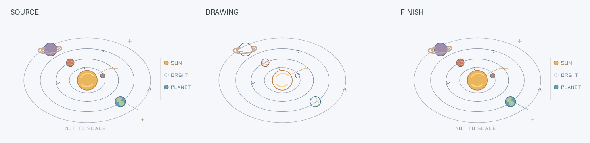
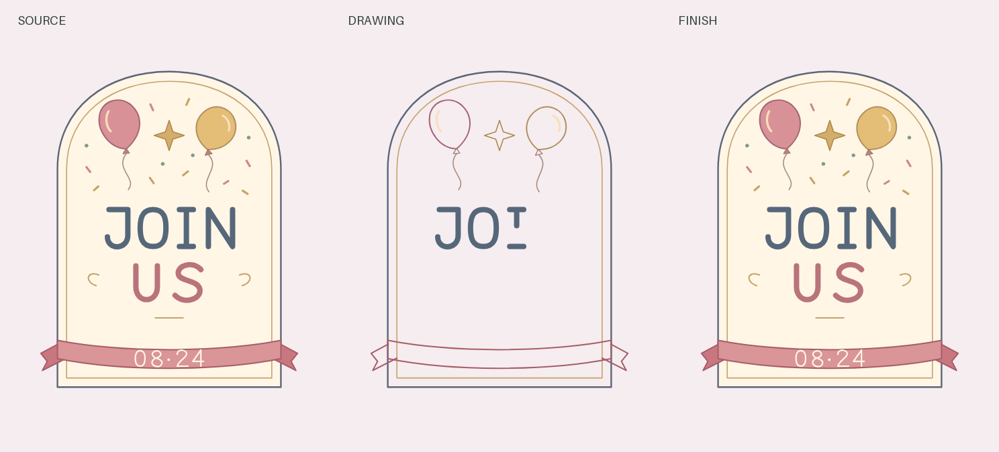

# TraceGIF cases: line animations for seven scenarios

Seven original examples you can inspect, download and revise. Each uses the same TraceGIF workflow: preserve the source, draw meaningful contours, reveal color, then verify the exported file offline.

[Download all cases](https://github.com/JulyanXu/tracegif/releases/download/v0.4.0/tracegif-cases-0.4.0.zip) · [Install TraceGIF](../../README.md#install-the-skill) · [中文说明](#中文案例)

The bundle contains an offline HTML, GIF, transparent PNG and editable project for each case. Open an HTML, choose a speed, optionally adjust **GIF settings**, then click **Save GIF**. These are demonstrations created for this project, not commissioned customer work or business-performance claims. All seven source designs are available under MIT.

## Leaf Studio — a botanical identity


**Use:** introduce a small brand or a presentation section with a restrained botanical mark. The leaf structure draws first; its smaller contours and green/gold color follow. The editable source is native SVG, so no automatic tracing or font substitution is involved.

**Try this request:** “Make the main leaf appear more slowly, keep the smaller details late, then give me a GIF for my project README.”

[Original SVG](../../examples/source/leaf-studio.svg) · [HTML file](leaf-studio/animation.html) · [GIF](leaf-studio/animation.gif) · [Transparent PNG](leaf-studio/final.png) · [Verification](leaf-studio/report.json)

## Coffee Story — a product illustration




**Use:** a coffee product introduction or a compact visual in a pitch deck. The cup, steam and beans give the animation a recognizable subject before color appears. Original SVG paths remain editable rather than being flattened into a video.

**Try this request:** “Start with the cup, show the steam later, and export a faster GIF plus a transparent final PNG.”

[Original SVG](../../examples/source/coffee-story.svg) · [HTML file](coffee-story/animation.html) · [GIF](coffee-story/animation.gif) · [Transparent PNG](coffee-story/final.png) · [Verification](coffee-story/report.json)

## White Letter Badge — keep the white details




**Use:** a badge or logo whose white lettering must remain visible. This case starts from a transparent PNG rendered from an original SVG. The aligned contours are supplied from that known source; final color uses the PNG pixels. It demonstrates preserved white interiors, not a claim that any raster logo can be perfectly traced automatically.

**Try this request:** “Keep the white letters intact, draw their contours last, and save the result as HTML, GIF and PNG.”

[Source design](../../examples/source/white-letter-badge.svg) · [Input PNG](white-letter-badge/source.png) · [HTML file](white-letter-badge/animation.html) · [GIF](white-letter-badge/animation.gif) · [Transparent PNG](white-letter-badge/final.png) · [Verification](white-letter-badge/report.json)

## Courtyard House — architecture and property




**Use:** introduce a residential facade in a property presentation or design portfolio. Structural paths establish the building before windows, planting and color. The landscape composition is an original architectural illustration, not a measured construction drawing.

**Try this request:** “Draw the building structure before the plants, slow the entrance to 1×, then export a GIF for the listing presentation.”

[Original SVG](../../examples/source/courtyard-house.svg) · [HTML](courtyard-house/animation.html) · [GIF](courtyard-house/animation.gif) · [PNG](courtyard-house/final.png) · [Verification](courtyard-house/report.json)

## City Route — travel and itinerary




**Use:** show an itinerary's route and stops in a travel proposal. The illustrated map is fictional and intended for storytelling, not navigation. Its paths and stop markers can be edited independently.

**Try this request:** “Reveal the route before the stop markers and make a compact 240-pixel GIF for the itinerary document.”

[Original SVG](../../examples/source/city-route.svg) · [HTML](city-route/animation.html) · [GIF](city-route/animation.gif) · [PNG](city-route/final.png) · [Verification](city-route/report.json)

## Orbit Lesson — education and explanation





**Use:** introduce an orbital diagram gradually in a lesson. This is a stylized schematic: distances, body sizes and orbital geometry are illustrative and not to scale. It draws the diagram; it does not simulate orbital physics.

**Try this request:** “Draw the orbit paths first, reveal the small bodies later, and keep a transparent PNG for my lesson slides.”

[Original SVG](../../examples/source/orbit-lesson.svg) · [HTML](orbit-lesson/animation.html) · [GIF](orbit-lesson/animation.gif) · [PNG](orbit-lesson/final.png) · [Verification](orbit-lesson/report.json)

## Celebration Card — events and invitations




**Use:** give a portrait invitation a drawn entrance. The frame, festive details and original outlined lettering stay editable without an external font. Its portrait aspect ratio is preserved in the preview and exports.

**Try this request:** “Let the invitation's lettering appear last, use a cream GIF background, and keep the original portrait proportions.”

[Original SVG](../../examples/source/celebration-card.svg) · [HTML](celebration-card/animation.html) · [GIF](celebration-card/animation.gif) · [PNG](celebration-card/final.png) · [Verification](celebration-card/report.json)

## What to compare

- The GIFs use a solid background; the HTML and PNG outputs retain transparency.
- Every preview comes from the actual renderer. Reports identify the exact HTML that was checked.
- Changing playback speed does not regenerate the artwork. Changing the source or timeline requires a new render and verification.
- GitHub displays the source of an HTML file. Download it and open it locally to try the player; the case bundle is the simplest way to get every file.

Each case's dimensions, duration, speed and background are recorded in its export report. Landscape and portrait proportions are preserved. The gallery GIFs use their selected solid matte; **GIF settings** in the HTML lets you choose a different width, frame rate or color. White remains the default.

After [installing the dependencies](../../README.md#install-the-skill), reproduce the cases from the repository root:

```text
python tools/build_cases.py --build-root build/cases --media-root build/cases/media
```

This creates fresh offline evidence and editable packages. Automated rebuilding leaves visual review marked unverified until a human or Agent inspects the new captures.

## 中文案例

**七个案例，七种使用场景：**植物品牌、咖啡产品、白字徽章、建筑展示、旅行路线、轨道教学和活动邀请。素材均为本项目原创演示，并附 MIT 许可，不代表真实客户项目或营销转化成绩。

下载案例包后，打开 HTML，调节速度，在 **GIF settings** 中选择尺寸、帧率与背景颜色，点击 **Save GIF** 即可离线生成 GIF。每个案例同时提供原稿、描线与成品对照、透明 PNG、可编辑工程和绑定 HTML 校验值的报告。

可以直接说：“杯子先出现，蒸汽晚一点”“保留白字”“总时长改为 8 秒，再导出 GIF”。Agent 会在原工程上修改并保留此前版本。

GIF 使用实色背景，HTML 和 PNG 保留透明度。白字案例的轮廓来自已知的原始 SVG，并非自动恢复任意图片的精确矢量路径。

各案例的尺寸、时长、倍速和背景参数均记录在导出报告中，横版、竖版保持原比例。建筑是演示插画，旅行地图为虚构路线，轨道图不按真实比例；它们用于展示可复用的制作方式。上面的命令可重新制作案例、导出全部格式并生成真实离线验证记录。
